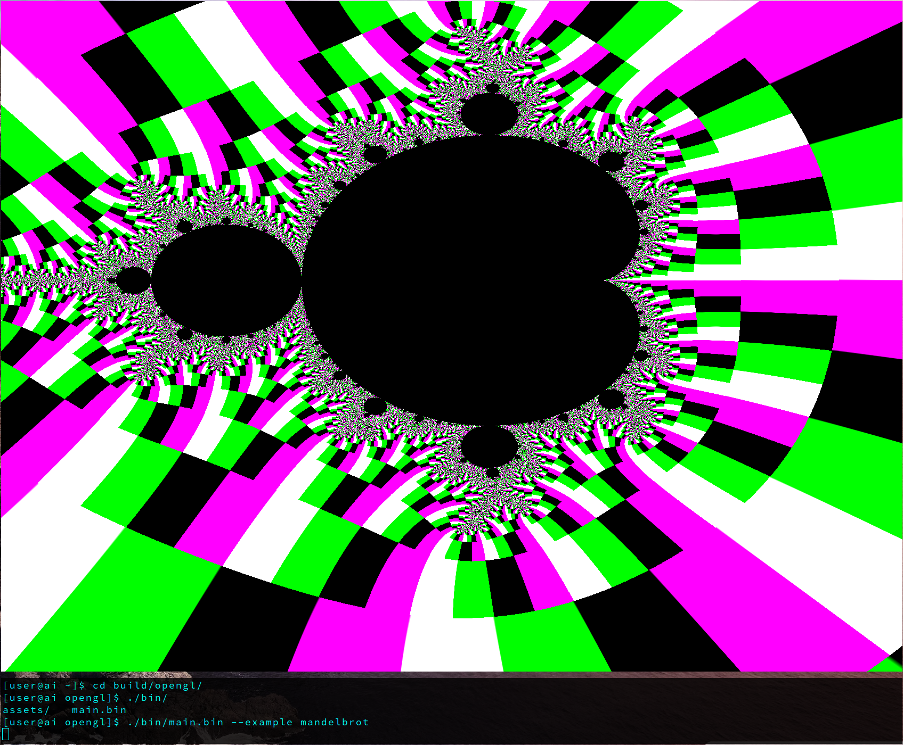

# LearnOpenGL - C

## About

My follow along of [LearnOpenGL](https://learnopengl.com/) but in C.

## Prerequisites

- glfw-x11, glad, cmake
- primary development OS is Arch Linux
  - command to install neccessary dependencies on the above platform is:
    - `sudo pacman -S base-devel glfw-wayland glfw-x11 mesa mesa-utils`
    - This will install GLFW, glad source code is included with the repo

## Usage

## Development

- When starting a new lesson
  - create a new folder in src/ based on the tab hierarchy found in https://learnopengl.com
    - ["Hello triangle"](https://learnopengl.com/Getting-started/Hello-Triangle) is placed in `src/1.getting_started/2.1.hello_triangle`
    - Add entry in `./src/main.c` to map keyword to render newly created example.
      - add import/include of new lesson
      - add mapping in main if/else clause to render the given example for a specific keyword
      - add entry to set render loop for the given example
- compile `make`
- run `./bin/main.bin --example name-of-example`

## Resources

- [LearnOpenGL](https://learnopengl.com/)
- [CGLM](https://github.com/recp/cglm)
- [Glad](https://glad.dav1d.de/#language=c&specification=gl&api=gl%3D4.6&api=gles1%3Dnone&api=gles2%3Dnone&api=glsc2%3Dnone&profile=core&loader=on)

## Example

